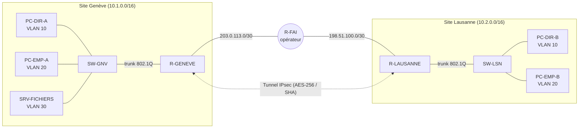

# Réseau multi-sites avec VPN IPsec site-à-site (GNS3)

> Conception et maquette d'un réseau pour une PME répartie sur deux sites (Genève et Lausanne), reliés par un tunnel **VPN IPsec** chiffré à travers un réseau opérateur simulé.

   

## Objectif

Une PME fictive possède un siège à Genève et une agence à Lausanne. Il faut :

- segmenter chaque site par service (VLAN Direction, Employés, Serveurs) ;
- router entre les VLAN (router-on-a-stick) ;
- relier les deux sites de façon **confidentielle** à travers Internet (VPN IPsec) ;
- documenter le plan d'adressage et justifier les choix.

*Projet réalisé dans le cadre de la formation E1A (Networking Essentials) au Geneva Institute of Technology. Le scénario est reformulé ; aucun énoncé de l'école n'est reproduit.*

## Topologie

## Plan d'adressage

| Site | VLAN | Rôle | Réseau | Passerelle | Hôte de test |
|---|---|---|---|---|---|
| Genève | 10 | Direction | 10.1.10.0/24 | 10.1.10.1 | PC-DIR-A 10.1.10.11 |
| Genève | 20 | Employés | 10.1.20.0/24 | 10.1.20.1 | PC-EMP-A 10.1.20.11 |
| Genève | 30 | Serveurs | 10.1.30.0/24 | 10.1.30.1 | SRV-FICHIERS 10.1.30.10 |
| Lausanne | 10 | Direction | 10.2.10.0/24 | 10.2.10.1 | PC-DIR-B 10.2.10.11 |
| Lausanne | 20 | Employés | 10.2.20.0/24 | 10.2.20.1 | PC-EMP-B 10.2.20.11 |
| WAN | — | Genève ↔ FAI | 203.0.113.0/30 | — | — |
| WAN | — | Lausanne ↔ FAI | 198.51.100.0/30 | — | — |

Les réseaux WAN utilisent des plages de documentation (RFC 5737) pour simuler des adresses publiques.

## Technologies

- **GNS3** avec routeurs **Cisco c7200** (IOS 15.2), switchs Ethernet GNS3 et hôtes VPCS
- VLAN 802.1Q, sous-interfaces (router-on-a-stick)
- Routage statique (route par défaut vers l'opérateur)
- **IPsec** : IKEv1 (ISAKMP), AES-256, SHA-HMAC, crypto map, ACL de trafic intéressant
- Wireshark (captures du trafic chiffré ESP sur le lien WAN)

## Étapes réalisées

1. Rédaction d'un plan d'adressage hiérarchique (un /16 par site, un /24 par VLAN).
2. Configuration des switchs : ports access par VLAN, port trunk 802.1Q vers le routeur.
3. Sous-interfaces `Gi0/0.10/.20/.30` avec `encapsulation dot1Q` sur chaque routeur de site.
4. Simulation de l'opérateur (R-FAI) et routes par défaut des routeurs de site.
5. Mise en place du VPN IPsec :
   - politique ISAKMP (AES-256, pre-shared key, groupe DH 5) ;
   - transform-set `esp-aes 256 esp-sha-hmac` en mode tunnel ;
   - ACL `VPN-TRAFIC` (10.1.0.0/16 ↔ 10.2.0.0/16) et crypto map appliquée sur l'interface WAN.
6. Tests : ping inter-VLAN, ping inter-sites, `show crypto isakmp sa`, `show crypto ipsec sa` (compteurs encaps/decaps).
7. Capture Wireshark sur le lien WAN : le trafic inter-sites n'apparaît plus qu'en **ESP**, les paquets ICMP ne sont plus lisibles.

## Configurations

Les configurations des équipements se trouvent dans [`configs/`](configs/).
**La clé pré-partagée VPN a été remplacée par `<REDACTED_PSK>`** : à remplacer par une clé longue et aléatoire pour reproduire le lab.

## Analyse sécurité et pistes d'amélioration

Ce lab est volontairement simple. Pour une mise en production, je recommanderais :

| Constat dans le lab | Amélioration |
|---|---|
| IKEv1 avec groupe Diffie-Hellman 5 (1536 bits, déprécié) | **IKEv2** avec groupe 19/20 (ECDH) ou au minimum 14 |
| Authentification par clé pré-partagée | Certificats (PKI) ou clé longue stockée chiffrée |
| `line vty` sans authentification locale | `login local`, `transport input ssh` uniquement, ACL d'accès admin |
| Pas de filtrage entre VLAN | ACL inter-VLAN (ex. Employés → Serveurs limité aux ports utiles) |
| Pas de journalisation | Syslog centralisé + NTP pour l'horodatage |

## Compétences acquises

- Conception d'un plan d'adressage IP multi-sites
- Segmentation réseau par VLAN et routage inter-VLAN
- Configuration et vérification d'un VPN IPsec site-à-site
- Analyse de trafic avec Wireshark (vérification du chiffrement)
- Lecture critique d'une configuration du point de vue sécurité

## Reproduire le lab

1. Installer GNS3 et importer une image Cisco c7200 **dont vous détenez la licence** (les images IOS ne sont pas fournies ici).
2. Recréer la topologie ci-dessus, puis coller les fichiers de `configs/` dans chaque équipement.
3. Remplacer `<REDACTED_PSK>` par une même clé sur les deux routeurs de site.

---
Auteure : **Rrudhani Deaa** — étudiante en réseaux et systèmes, orientée cybersécurité.
